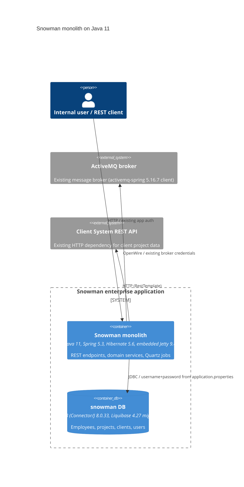

# 0001. Upgrade Snowman runtime from Java 7 to Java 11

- **Status:** Proposed
- **Date:** 2026-09-24
- **ARB ticket:** TO BE CREATED
- **Authors:** Devin (on behalf of the Snowman maintainers)
- **Owning team:** TBD — owner to confirm before ARB (no CODEOWNERS / service catalog entry in repo)
- **Related ADRs:** none (first ADR in this repository)

## Context

Snowman (`monolith-enterprise-application`) is a Maven-built Java monolith (Spring + Hibernate + embedded
Jetty + ActiveMQ + Quartz + Liquibase/MySQL) that targets Java 1.7 and depends on end-of-life
libraries (Spring 4.3, Hibernate 5.4, PowerMock 1.7, Mockito 1.x). Several dependencies are declared
with open version ranges (e.g. `[4.3.18,)`), so the default branch currently resolves Spring 7.x and
fails to compile on JDK 8 (`class file has wrong version 61.0, should be 52.0`). Java 7 no longer
receives public security updates and is unavailable on modern build agents.

This ADR covers moving the build, runtime and CI to Java 11 (LTS), pinning all dependency versions,
and upgrading the framework stack to Java 11-compatible releases. No new services, data stores,
vendors or network boundaries are introduced; the JPMS module system is deliberately not adopted.

ARB triggers: T7 (runtime / framework major upgrade: JDK 7 -> 11, Spring 4.3 -> 5.3,
Hibernate 5.4 -> 5.6, Jetty 9.4.11 -> 9.4.57, Mockito 1 -> 4 / PowerMock removed). Not triggered:
T1, T2, T3, T4, T5, T6, T8, T9.

## Decision

We will build and run Snowman on Java 11 (`maven-compiler-plugin` `<release>11</release>`), pin every
dependency to a fixed version, upgrade the core stack to Spring 5.3.39 / Hibernate 5.6.15 /
Jetty 9.4.57 / Jackson 2.13.5 / MySQL Connector/J 8.0.33 / ActiveMQ 5.16.7 / Liquibase 4.27, replace
PowerMock + mockito-all with mockito-core + mockito-inline (`MockedStatic`), add the standalone
`javax.annotation-api` that JDK 11 no longer bundles, and run CI on OpenJDK 11. The application stays
on the classpath (no `module-info.java`).

## Alternatives considered

| Alternative | Pros | Cons | Why rejected |
| --- | --- | --- | --- |
| Do nothing (stay on Java 7) | Zero effort | JDK 7 is EOL and absent from build agents; open version ranges already break the build; PowerMock/Mockito 1 unmaintained | Build is already non-reproducible and failing |
| Upgrade straight to Java 17/21 with Spring 6 / Hibernate 6 (Jakarta) | Longer support horizon | Requires `javax` -> `jakarta` namespace migration across Spring, Hibernate, Jetty 11+, validation; much larger blast radius | Out of scope for this step; Java 11 is a supported LTS stepping stone and keeps the `javax` stack |
| Java 11 runtime but keep Spring 4.x / Hibernate 5.4 | Smaller diff | Spring 4.x does not officially support Java 11; Mockito 1/PowerMock 1.7 fail on JDK 11 | Would not yield a supported stack |

## Architecture

No component, data store or external system is added or removed; only the runtime/library versions
inside the existing container change.

## Non-functional requirements

| NFR | Target | How met |
| --- | --- | --- |
| Availability SLO | Unchanged from current deployment — TBD, owner to confirm before ARB | No topology change |
| p95 latency | Unchanged — TBD, owner to confirm | Same code paths; JDK 11 G1 default GC |
| RPO / RTO | Unchanged — TBD, owner to confirm | Data store untouched |
| Peak load | Unchanged — TBD, owner to confirm | N/A |
| Scaling model | Single JVM (existing) | N/A |
| Data retention | Unchanged | Liquibase migrations preserved as-is |

## Security & compliance

- **Data classification:** unchanged (employee/project/client/user records already held in MySQL).
- **Encryption at rest:** N/A — no data store change; inherits current MySQL configuration.
- **Encryption in transit:** unchanged; JDK 11 adds TLS 1.3 support to the runtime.
- **AuthN / AuthZ:** unchanged; no auth code touched.
- **Secrets:** unchanged (JDBC/ActiveMQ credentials in `application.properties`; pre-existing
  placeholder values, not introduced here).
- **Audit logging:** unchanged (SLF4J 1.7.36).
- **Data residency / regions:** N/A — no infrastructure change.
- **Policy sections satisfied:** no infrastructure resources are created or modified.
- **Threats considered:** upgrading removes known CVEs in Spring 4.3.x, Jackson 2.8.x, MySQL
  Connector 8.0.16, ActiveMQ 5.10, Jetty 9.4.11; version pinning removes supply-chain drift from open
  version ranges.

## Cost

| Item | Assumption | Monthly estimate |
| --- | --- | --- |
| Runtime | Same host footprint; JDK 11 memory profile comparable to JDK 7 for this workload | $0 incremental |
| **Total** | | $0 incremental (below $500 threshold) |

## Operations

- **On-call rotation:** unchanged — TBD, owner to confirm before ARB.
- **Runbook:** `README.md` (build/run instructions updated to JDK 11).
- **Dashboards / alarms:** unchanged.
- **Rollback plan:** revert the PR; the previous artifact requires a JDK 7/8 runtime and re-pinning
  of Spring 4.3.x (the open ranges on `master` no longer resolve to a buildable set).
- **Migration / cut-over plan:** install JDK 11 on build agents and hosts (`.travis.yml` moved to
  `openjdk11`); deploy `target/Snowman.jar` via existing `run.sh`; no schema changes.

## Policy exceptions requested

| Rule | Resource | Justification | Compensating control | Expiry |
| --- | --- | --- | --- | --- |
| none | | | | |

## Consequences

- Positive: supported LTS runtime; reproducible builds (no version ranges); CVE-bearing libraries
  upgraded; PowerMock removed, unblocking future Mockito/JUnit upgrades.
- Negative / risks: Hibernate 5.4 -> 5.6 and Spring 4 -> 5 behaviour changes are only covered by
  unit tests (no integration tests against MySQL in the repo); Liquibase 3 -> 4 changes checksum
  handling and should be validated against a copy of the production DB before rollout.
- Follow-ups: fix 13 pre-existing unit-test failures (present on `master` with JDK 8); plan
  Java 17/21 + Jakarta migration as a subsequent ADR.

## Open questions

- Owning team, on-call rotation and SLO figures for the NFR table.
- Whether a Liquibase 4 dry-run (`updateSQL`) against a production snapshot is required before deploy.
